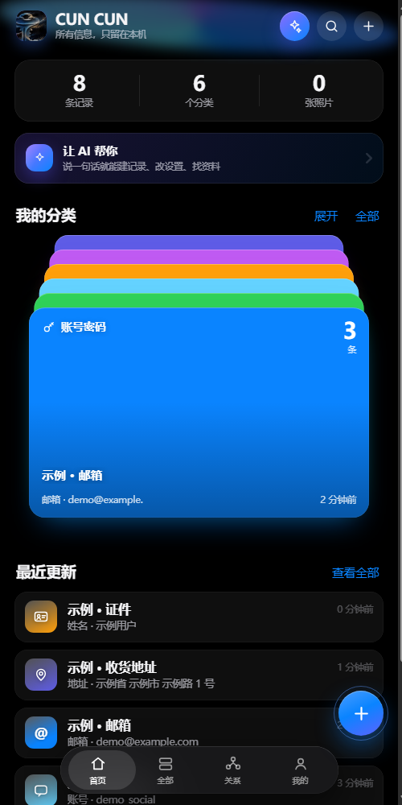
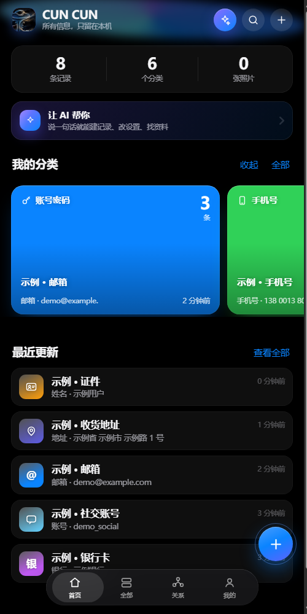
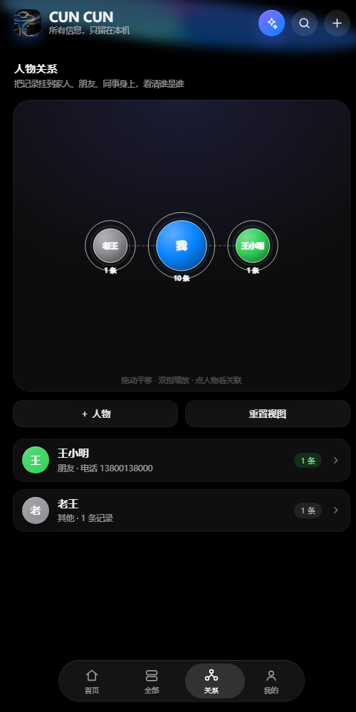
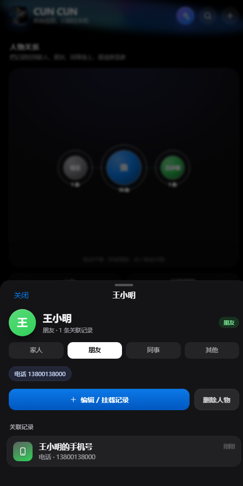

# 存存 CUN CUN

一个**只把密码存在自己手机里**的 Android 小应用。界面用纯本地 HTML/CSS/JS 写，装在一个极简 WebView 外壳里，没有后端、没有云同步、没有账号体系。

再配一个**你自己填 Key 的 AI 助手**：说一句话（"我妈妈李阿姨电话 138 0013 8000"），它就把人物和记录一起建好；但所有数据依旧只写在本机的 `localStorage`，AI 只负责"听懂"，不负责"保管"。

- 包名：`com.cuncun.app`
- 版本：1.5.1（versionCode 14）
- 作者：郑鸣阳 · 3372991529@qq.com
- 仓库：https://github.com/zmy531/cuncun

---

## 功能

### 记录
- 8 个分类：账号密码 / 手机号 / 社交账号 / 身份证件 / 户口本 / 银行卡 / 地址电话 / 其他
- 每条记录 = 标题 + 分类 + 任意多组「字段 / 值」+ 照片 + 备注，可置顶
- 详情面板：查看、复制单个字段、编辑、删除；字段可随时增删
- 搜索：标题、备注、分类名、所有字段值都能命中
- 导入导出：导出自带格式的文本，导入时容错解析（整段"账号 密码"也能拆开）

### 首页
- 「我的分类」默认是**一摞可展开的卡片**：后面几张只露一条色边，点卡片或右上角「展开」散成横滑大卡，再点「收起」叠回去
- 统计条数字滚动，最近更新列表错峰淡入

### 人物关系
- 只有**人物关系**，不做"账号关系"那一套
- 关系图：我在中间，家人 / 朋友 / 同事 / 其他四种颜色的人围绕分布（人数为偶数时自动错半格，不会排成一条竖线）
- 点圆点或下方人物卡 → **人物详情面板**：头像、关系、名下所有联系方式胶囊（点一下即复制）、完整关联记录列表（点进去就是记录详情）
- 详情里可以直接改关系、挂载 / 解绑记录、删除人物（只解关联，不删记录）
- 手势：单指拖动平移、双指缩放、重置视图；轻点判定 14px，手指偏一点也能选中节点

### AI 助手
- 自填 OpenAI 兼容接口：`Base URL` + `Model` + `API Key`，带"测试连接"
- 支持的指令（本地意图 + AI 动作两种路径都走同一套执行器）：
  - 建记录：`招商银行卡号 6222 0000 1234 5678 密码 Ab123456` → 直接入库，不再弹表单
  - 建人物 + 挂记录：`我的妈妈李阿姨电话 138 0013 8000` → 建「李阿姨 · 家人」并把记录挂在她名下
  - 提问：`我一共有几条记录`、`李阿姨的电话是多少`、`我有几张银行卡` → 只回答，不会误建数据
  - 改设置：震动强度、隐私模式、打开密码、导出、搜索、跳转页面
- 没配 AI 时，本地意图仍然可用（不联网也能听懂常见说法）

### 其它
- 应用锁（打开需要密码，PBKDF2 + AES 加密记录到 localStorage）
- 隐私模式（`FLAG_SECURE`，系统截屏 / 录屏全黑）
- 触感反馈四档、深色手钥匙图标、启动引导与「使用守则」

---

## 截图

| 首页（堆叠） | 展开横滑 | 关系网 | 人物详情 |
| --- | --- | --- | --- |
|  |  |  |  |

> 截图里的人物、号码、账号都是虚构的示例数据（`138 0013 8000`、`demo@example.com` 之类），首次启动看到的也是这一份，可以随便改。

---

## 安装

从 [Releases](https://github.com/zmy531/cuncun/releases) 下载 `cuncun-1.5.1.apk`，手机上允许"安装未知来源应用"后安装。

- 最低 Android 8.0（API 26），目标 API 34
- 覆盖安装用同一个签名即可，数据保留

## 第一次使用

1. 启动 → 点「我同意」进入
2. 想用 AI：我的 → AI 助手 → 填 Base URL / 模型 / Key → 测试连接
3. 随口说一句就行，比如「我妈李阿姨手机号 138 0013 8000」，然后去关系页看，她已经在图上并挂着这条记录（示例号码是虚构的 138 0013 8000）

---

## 数据与隐私

- 记录存在 WebView 的 `localStorage`（键 `cc.items`），人物在 `cc.persons`，设置与旗标在 `cc.settings` / `cc.onboard` / `cc.seeded`
- 应用不申请联网权限以外的系统权限；照片走系统选择器，只读取你选中的那张
- AI 请求只在你主动发消息时发生，发出去的是你那句话（以及必要的历史上下文），**不会同步本地记录库**
- 开启应用锁后，记录整体加密后再落盘；密码不上传、不备份

> 提醒：这是自用项目，别把同一把钥匙交给所有人。真要长期存放重要凭据，建议额外做离线备份（导出文本 + 自己加密保存）。

---

## 目录结构

```
cuncun/
├─ AndroidManifest.xml        # 包名 / 版本 / 权限
├─ build.ps1                  # 无 Gradle 构建脚本（aapt2 → javac → d8 → zipalign → apksigner）
├─ assets/www/                # 整个 UI（纯前端）
│  ├─ index.html              # 结构 + 所有面板
│  ├─ app.css                 # 主题、卡片、关系图、动效
│  ├─ app.js                  # 渲染、存储、关系网、AI 意图与执行器
│  ├─ seed.js                 # 首次启动的示例数据
│  └─ img/cuncun.png          # 应用内图标
├─ java/com/cuncun/app/
│  └─ MainActivity.java       # WebView 外壳 + 原生桥（复制/震动/存文件/选图/HTTP/键盘 inset）
├─ res/                       # 图标、主题、启动背景
├─ icon-source.png            # 图标原图
└─ cuncun-1.5.1.apk           # 已签名安装包
```

主要几个可改的地方：

| 想改什么 | 看哪里 |
| --- | --- |
| 分类名 / 颜色 / 默认字段 | `assets/www/app.js` 里 `CATS` |
| 人物关系四种类型 | `RELS` |
| 首页卡片堆叠与展开 | `applyStack()` / `toggleStack()` + `app.css` 的 `.wallet.stacked` |
| 关系图布局与点击 | `drawPeople()` / `nearestNode()` / `bindGraphGestures()` |
| 人物详情面板 | `openPersonDetail()` / `renderPersonList()` |
| AI 提示词与本地意图 | `AI_SYS` / `localIntent()` / `localAnswer()` / `execActs()` |
| 键盘弹出与安全区 | `MainActivity` 的 `onApplyWindowInsets` + `app.js` 的 `syncKb()` |

---

## 从源码构建

不需要 Android Studio 和 Gradle，直接用 SDK 里的命令行工具：

```powershell
# 1. 准备 JDK 17 + Android SDK（build-tools 34.0.0、platform android-34）
# 2. 改 build.ps1 顶部的路径
$dev  = 'C:\Users\Lenovo\cuncun-dev'   # 改成你自己的工具链目录
$sdk  = "$dev\sdk"
$jdk  = "$dev\jdk-17.0.2"

# 3. 构建
powershell -ExecutionPolicy Bypass -File .\build.ps1
```

脚本会依次：`aapt2 compile` → `aapt2 link` → `javac` → `d8` → 把 `classes.dex` 与 `assets/**` 写回 APK（强制正斜杠，否则 AssetManager 读不到）→ `zipalign` → `apksigner`，最后输出 `cuncun-1.5.1.apk`。

签名默认读 `keys/cuncun.jks`（alias `cuncun`）。**发布自己的版本请换掉密钥与密码**，脚本里的口令只是本地自用。

> 注意：`build.ps1` 必须保存为 **UTF-8 带 BOM**，否则 PowerShell 5.1 会报 `UnexpectedToken`；`MainActivity.java` 反过来**不能**带 BOM，否则 `javac` 报非法字符。

---

## 版本历史

| 版本 | 主要内容 |
| --- | --- |
| 1.0 | 记录增删改查、分类、搜索、导入导出 |
| 1.1 | 应用锁与加密、关系网、触感四档、图标替换 |
| 1.2 | 启动引导 / 使用守则、品牌位改成 CUN CUN、批量识别（后移除） |
| 1.3 | 记录详情改为单层面板、24 个平台品牌图标、AI 常驻入口；修复收起态面板仍渲染导致的"串页" |
| 1.4 | 首页分类卡堆叠 + 展开、人物详情面板、AI 一句建人物+记录、键盘 inset 双算修正、原生键盘高度兜底 |
| 1.5.1 | 人物详情可直接改关系、联系方式胶囊点击即复制、AI 单条记录直存并把标题统一成「人名 + 的 + 分类」、关系图节点定位改用 CSS 变量不被缩放动画带偏、首页数字滚动与卡片错峰展开 |
| 1.5 | 关系网节点点击改用几何命中 + 尺寸放大、人物列表显示联系方式摘要、详情可直接改关系/复制字段、AI 单条记录直存不弹表单、首页数字滚动与展开错峰动画、关系图节点定位不再被缩放动画带偏 |

---

## 已知限制

- 只做了深色主题
- 关系图不自动避让，人物超过 10 个时建议靠缩放查看
- AI 需要自备可用的 OpenAI 兼容接口；模型能力差异会直接影响"听懂"的效果
- 照片以 base64 存在本地，数量多时体积增长较快（设置里能看到实时占用）

---

## 许可

MIT，见 [LICENSE](LICENSE)。请勿用于存储他人凭据。
